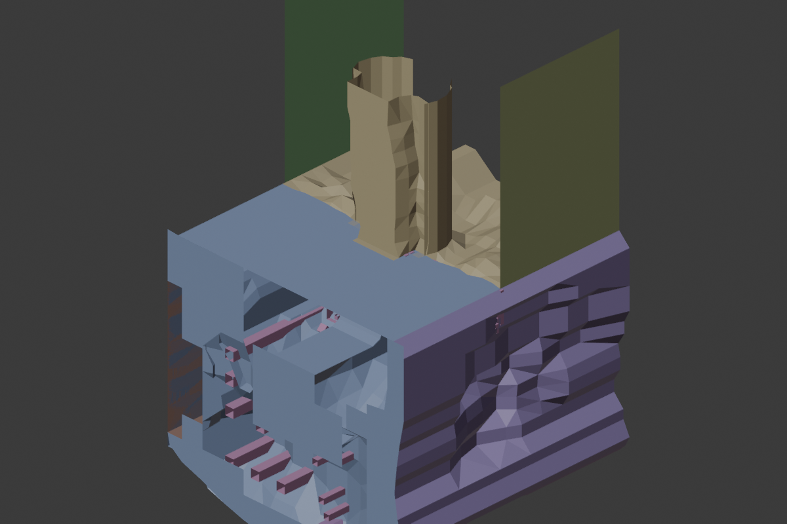

# map004 静态几何验证

本轮将静态结构审计推进到实际三维载入：6 个 Earth 模型、9 个网格、8,358 顶点、6,583 面已由 Blender 5.2.2 LTS 成功载入并生成预览。原始文件未修改。



这张图使用 Blender 诊断颜色，所有网格以原始局部 XYZ 重叠展示。Blender 与源游戏的上轴约定尚未核验，因此画面方向不代表原游戏方向。未应用 Frame 矩阵、场景变换、材质、原始法线、顶点色、骨骼、动画与特效；不是完整场景重建。未进行轴转换、单位缩放、修面或多边形三角化。Blender 渲染内部三角化不改变保存的多边形数据。

## 文件与验证

- `godot/assets/static_sample/manifest.json`：精确资源 ID、源路径、源 SHA256、派生 OBJ/JSON SHA256、数量和明确省略项。
- `godot/assets/static_sample/*.obj`：局部几何与原始 UV；无 MTL。
- `godot/assets/static_sample/*.mesh.json`：原始顶点、多边形索引和 UV，便于重建或跨工具核验。
- `godot/diagnostics/map004_local_geometry.blend`：成功载入后的 Blender 文件。
- `original_resources/manifests/static_sample_blender_validation.json`：实际 Blender 版本及逐网格验证数量。
- `godot/project.godot`：面向 Godot 4.x 的检查工程；Godot 引擎尚未安装/发现，脚本解析、OBJ 导入和运行待实际验证，不能据此声称验收通过。

导出前将每个源模型 SHA256 与资源目录核对；导出后回读 OBJ 验证全部顶点值及顶点/面数量。Blender 验证逐面索引一致、顶点在单精度误差范围内一致，并保留每个面角的 UV。

## 复现

在仓库根目录执行：

```sh
python3 tools/resource_pipeline/static_sample.py
/Applications/Blender.app/Contents/MacOS/Blender --background --python tools/resource_pipeline/blender_static_sample.py
```

Blender 在受限沙箱启动时曾退出 139，允许本地应用执行后成功完成，未修改系统设置。重复运行 Blender 可能产生 `.blend1` 备份；这是诊断输出，不属于原资源。

## 下一步

先在选定 Godot 4.x 版本执行编辑器导入和运行检查，再逐项加入 Frame/场景矩阵、源材质/贴图与透明规则，对比原游戏参考。角色与技能验证继续使用已有 ANT、脚本和粒子依赖索引，不把静态 OBJ 当作动画资产。

格式选择参考：[Godot 官方支持的三维格式](https://docs.godotengine.org/en/stable/tutorials/assets_pipeline/importing_3d_scenes/available_formats.html)。OBJ 仅用于静态几何诊断；骨骼与动画后续采用经过验证的其他格式。相机接口参考：[Camera3D](https://docs.godotengine.org/en/stable/classes/class_camera3d.html)。
